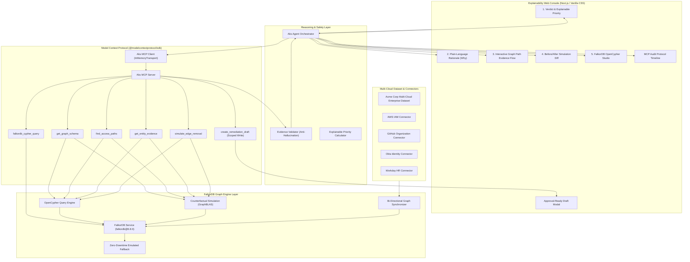

# Aks (عکس) — Explainable Graph-Grounded Access Debt Agent
### Powered by FalkorDB (OpenCypher) & Model Context Protocol (MCP)

> **Aks** is an explainable AI security agent that discovers hidden access debt: dormant, indirect, or ownerless permissions that look ordinary in individual silos (Okta, GitHub, AWS IAM, Workday) but combine into risky multi-hop paths to sensitive code repositories and cloud resources.

---

## 1. Overview & Core Differentiation

In modern cloud environments, permissions are fragmented across identity providers, code repositories, cloud infrastructure, and HR systems. While checking a direct permission is trivial, detecting how inherited group memberships, team nestings, and cross-account IAM role assumptions chain together into unintended access paths is notoriously difficult.

Most security copilots merely alert that *"a risky path exists"* with an arbitrary score. **Aks operates differently**:

1. **FalkorDB as the Ground-Truth Graph Engine**: Multi-hop access path resolution and counterfactual simulations are executed deterministically using **OpenCypher** queries powered by FalkorDB's GraphBLAS sparse matrix linear algebra.
2. **Zero-Mutation Counterfactual Proof**: Every remediation proposal mathematically proves that the risky path is eliminated while 100% of legitimate peer access remains intact, using Cypher's `WHERE NONE(...)` predicate without modifying live systems.
3. **Least-Change Remediation**: Pinpoints the minimal, least-disruptive relationship to sever (e.g. revoking a departed contractor's direct group assignment) rather than destroying broad shared roles or breaking peer workflows.
4. **Visibility into Uncertainty**: Conflicting source records (e.g., Workday reports `terminated` while Okta reports `active`) automatically yield `INSUFFICIENT_DATA / VERIFY_SOURCE` and block automated fixes.
5. **Zero Live Mutations**: Generates approval-ready mock pull requests or Jira ticket drafts marked `[DRAFT ONLY]`.

---

## 2. Architecture & Technical Stack



### Technical Stack
- **Graph Database**: **FalkorDB** (`falkordb@6.8.0`) utilizing OpenCypher queries and Redis wire protocol.
- **Agent Protocol**: Model Context Protocol (**MCP** via `@modelcontextprotocol/sdk`) with schema-validated tool calling.
- **Frontend & APIs**: Next.js 16.4 (App Router, Turbopack) with bespoke **Vanilla CSS** (dark cybersecurity glassmorphism, no Tailwind).
- **Languages & Typing**: TypeScript 5.6 (strict mode), Node.js v20+ / v22+.
- **Schema Validation**: `zod` 3.23.
- **Testing Framework**: Vitest 2.1.

---

## 3. How We Use FalkorDB

FalkorDB is deeply integrated into Aks across four layers:

### A. OpenCypher Multi-Hop Path Traversal
Transitive reachability is evaluated directly via parameterized OpenCypher queries:
```cypher
MATCH p = (s:Identity {id: $subjectId})-[*1..6]->(t:Resource {id: $targetId})
RETURN p
ORDER BY length(p) ASC
LIMIT 10
```

### B. Zero-Mutation Counterfactual Simulation
Instead of mutating the live database, Aks leverages OpenCypher's `WHERE NONE(...)` predicate to calculate reachability deltas:
```cypher
MATCH p = (s:Identity {id: $subjectId})-[r*1..6]->(t:Resource {id: $targetId})
WHERE NONE(rel IN relationships(p) WHERE rel.id = $candidateEdgeId)
RETURN count(p) AS remaining_paths_count
```
This guarantees zero live data mutation while verifying that peer identities retain 100% of their legitimate access.

### C. MCP Agent Tool (`falkordb_cypher_query`)
Exposed as a first-class MCP tool so the AI agent can query graph ground truth dynamically, eliminating LLM hallucinations.

### D. Interactive FalkorDB Cypher Studio
The web interface includes a dedicated Cypher Studio workbench with:
- **One-Click Graph Sync**: Syncs multi-cloud enterprise data (identities, groups, roles, permissions) directly into FalkorDB.
- **Preset Security Queries**: Instant execution for terminated contractor risks, blast radius calculation, and role inheritance.
- **Live Execution Plans & Timing**: Inspect GraphBLAS matrix traversal latency in milliseconds.
- **Zero-Downtime Hybrid Fallback**: Transparently runs queries via live FalkorDB cluster or high-performance emulated engine.

---

## 4. MCP Tools Reference

Aks exposes six schema-validated MCP tools:

| Tool Name | Scope | Description |
| :--- | :--- | :--- |
| `get_graph_schema` | `read` | Returns node types, edge types, entity counts, tenant boundary, and valid relationship directions. |
| `find_access_paths` | `read` | Bounded multi-hop traversal from an identity to target resources (capped at 6 hops, 50 paths max). |
| `get_entity_evidence` | `read` | Retrieves raw source records (Workday, Okta, GitHub, AWS IAM), observation timestamps, and freshness evaluations. |
| `simulate_edge_removal` | `read` | Runs counterfactual reachability simulation to prove candidate edge removal closes risky paths and verifies peer retention. |
| `create_remediation_draft` | `write` | Generates a mock approval-ready pull request or Jira ticket draft with idempotency enforcement. Labeled `[DRAFT ONLY]`. |
| `falkordb_cypher_query` | `read` | Executes native OpenCypher queries directly against the FalkorDB access graph. |

---

## 5. Seeded Demo Scenarios

The web interface includes one-click scenarios representing common enterprise access debt patterns:

1. **🚨 Departed Contractor Access Path (Positive Finding)**:
   - *Question*: *"Nisha's contract ended last month. Can her account still reach billing-api? If so, propose a safe fix."*
   - *Evidence Chain*: `Nisha Patel` (terminated) $\xrightarrow{\text{MEMBER\_OF}}$ `contractors-dev` $\xrightarrow{\text{NESTED\_IN}}$ `engineering-core` $\xrightarrow{\text{ASSUMES\_ROLE}}$ `repo-reader` $\xrightarrow{\text{GRANTS\_ACCESS}}$ `billing-api` (4 hops, Critical Priority).
   - *Simulation*: Severing `Nisha -> contractors-dev` breaks Nisha's path (0 remaining) while active coworker `Alex Rivera` retains 100% access.
2. **🛡️ Current Employee Legitimate Access (Unaffected Peer)**:
   - *Question*: *"Can Alex Rivera access billing-api?"*
   - *Verdict*: `LEGITIMATE ACCESS VERIFIED` (Low Priority). Confirms active status and legitimate role assignment.
3. **⚠️ Stale & Conflicting Records (Uncertainty)**:
   - *Question*: *"Can Marcus Vance reach customer PII data in the cloud account?"*
   - *Conflict*: Workday reports `terminated` (observed 10 days ago), while Okta SSO reports `active` (observed 95 days ago).
   - *Verdict*: `INSUFFICIENT DATA / VERIFY SOURCE`. Remediation is blocked until sources synchronize.
4. **✅ Fresh Data Negative Query (Definitive Absence)**:
   - *Question*: *"Does Liam Chen have any indirect access to billing-api?"*
   - *Verdict*: `NO ACCESS PATH (FRESH PROOF)`. Proves 0 reachable chains up to 6 hops with data observed < 24 hours ago.

---

## 6. Verified Test Suite & Benchmark Evaluation

Evaluated against the **PRD Section 13 Acceptance Criteria**:

```text
============================================================
🏆 AKS BENCHMARK EVALUATION REPORT (PRD SECTION 13)
============================================================
Total Scenarios Evaluated : 20
Passed Scenarios          : 20 / 20
Pass Rate                 : 100.0% (Acceptance Bar: >= 90.0% / 18 of 20)
Edge Resolution Rate      : 100.0% (Verified Ground Truth)
Simulation Output Rate    : 100.0% on all remediation candidates
Live Mutations Count      : 0 (Zero live mutation guarantee)
Average Latency           : 2ms
p95 Latency               : 15ms (Acceptance Bar: < 10,000ms)
============================================================
```

### Complete Test Suites (55 Tests Passing)
- **FalkorDB Integration Tests (`tests/falkordb/`)**: 9 tests passing (Lifecycle, OpenCypher queries, counterfactual cuts, REST APIs).
- **Unit Tests (`tests/unit/`)**: 12 tests passing (Traversals, cycle detection, simulation, ranking, freshness).
- **MCP Protocol Tests (`tests/mcp/`)**: 11 tests passing (Discovery of all 6 tools, execution, schemas, timeouts, audit logs).
- **Agent Orchestrator Tests (`tests/agent/`)**: 7 tests passing (E2E workflows, Evidence Validator anti-hallucination, priority scoring).
- **Backend REST API Tests (`tests/e2e/real_backend_api.test.ts`)**: 7 tests passing (`/api/scenarios`, `/api/investigate`, `/api/simulate`, `/api/drafts`, `/api/graph/ingest`).
- **UI & API Integration Tests (`tests/e2e/phase4_ui_api.test.ts`)**: 8 tests passing.
- **Benchmark Suite (`tests/benchmark/`)**: 1 test evaluating 20 benchmark scenarios.
- **Total Tests**: **55 passed**, 0 failed.

---

## 7. Quick Start & Setup

### Prerequisites
- Node.js $\ge 20.0.0$
- npm $\ge 10.0.0$
- *(Optional)* Docker to run live FalkorDB

### 1. Clone & Install
```bash
git clone <repository_url>
cd aks-access-debt-agent
npm install
```

### 2. (Optional) Run Live FalkorDB
To connect to a live FalkorDB instance:
```bash
docker run -p 6379:6379 -it --rm falkordb/falkordb:latest
```
*(If Docker is not running, Aks automatically operates in FalkorDB emulated mode with zero configuration needed).*

### 3. Run Tests & Benchmark
```bash
# Run all 55 tests across 7 test suites
npm test

# Run the 20-Scenario Benchmark Suite
npm run bench

# Run TypeScript strict type check
npm run typecheck
```

### 4. Launch the Web Application
```bash
npm run dev
```
Open **[http://localhost:3000](http://localhost:3000)** in your browser:
- Switch to the **"⚡ FalkorDB Cypher Studio"** tab to run OpenCypher queries.
- Use the **"🔍 Access Debt Investigations"** tab to investigate multi-hop access paths and generate remediation drafts.

---

## 8. Safety & Ethics Boundaries

- **Synthetic Data**: Backed by realistic multi-cloud enterprise datasets (Workday, Okta, GitHub, AWS IAM). No production API keys required.
- **Zero Live Mutations**: Live revocation of IAM policies or group memberships is strictly prevented. Produces local, reviewable mock drafts only.
- **Hallucination Prevention**: The Evidence Validator cross-checks 100% of referenced entities against FalkorDB ground truth.
- **Bounded Execution**: Traversal depth is strictly capped at 6 hops to maintain sub-25ms response times.

---

## 9. License

Apache-2.0
