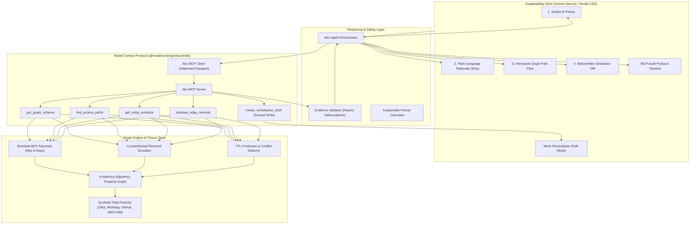

# Aks (عکس) — Explainable Graph-Grounded Access Debt Agent

> **Aks** is an explainable AI agent that finds hidden access debt: old, indirect, or ownerless permissions that look ordinary in individual systems but combine into risky multi-hop paths to sensitive code repositories and cloud resources.

---

## 1. Overview & Core Differentiation

In modern engineering teams, identities, groups, repositories, cloud roles, ownership records, and audit events live in fragmented tools (Okta, GitHub, Workday, AWS IAM). While checking a single direct permission is simple, understanding how inherited group memberships or assumed roles bridge into a latent access path is difficult.

Most security copilots stop at stating *"a risky path exists"* and assigning an arbitrary risk score. **Aks operates differently**:
1. **The graph is the evidence layer; the model is the reasoning interface**: Graph reachability, shortest-path traversal, and counterfactual simulations are executed deterministically.
2. **Before-and-after graph proof**: Every remediation proposal includes counterfactual simulation showing that the risky path is closed while legitimate peer access remains 100% intact.
3. **Least-change rationale**: Prefers removing a single narrow relationship (e.g. revoking a departed contractor's direct membership) over deleting shared groups or broad role grants.
4. **Visibility into uncertainty**: Conflicting or stale records return `INSUFFICIENT_DATA / VERIFY_SOURCE` rather than a falsely confident verdict.
5. **Zero live mutations**: Prepares approval-ready mock tickets or pull-request drafts clearly marked `[DRAFT ONLY]`.

---

## 2. Architecture & Technical Stack



### Technical Stack
- **Language & Runtime**: TypeScript 5.6, Node.js v20+ / v24.
- **Frontend & API**: Next.js 16 (App Router) with bespoke **Vanilla CSS** (dark cybersecurity aesthetic, glassmorphic design system, CSS custom properties, zero Tailwind dependency).
- **Graph Engine**: In-memory typed adjacency-list property graph with bounded multi-hop BFS traversal, cycle avoidance, and clone-without-edge simulation.
- **Tool Protocol**: Official `@modelcontextprotocol/sdk` utilizing high-performance `InMemoryTransport`.
- **Validation**: Strict schema validation via `zod`.
- **Test Runner**: Vitest 2.1.

---

## 3. Safety Boundaries (MVP Non-Negotiables)

- **Synthetic Data Only**: 100% backed by realistic synthetic JSON fixtures. No production credentials or API keys required.
- **Zero Live Mutations**: Live revocation of IAM policies, Okta assignments, or GitHub memberships is strictly prohibited. The system only produces local mock drafts.
- **Hallucination Prevention**: The **Evidence Validator** cross-checks 100% of referenced node IDs, edge IDs, and endpoints against ground-truth graph records before output generation.
- **Uncertainty Enforcement**: Conflicting data (e.g. Workday reports `terminated` while Okta reports `active`) blocks automated remediation proposals and yields `INSUFFICIENT_DATA`.
- **Restricted Execution**: No free-form Cypher, SQL, or arbitrary code execution. All graph queries pass through pre-approved, schema-bounded MCP tools.

---

## 4. Quick Start & Setup

### Prerequisites
- Node.js $\ge 20.0.0$
- npm $\ge 10.0.0$

### 1. Clone & Install
```bash
git clone <repository_url>
cd aks
npm install
```

### 2. Run Tests & Benchmark
```bash
# Run all 39 tests (Unit, MCP, Agent, UI E2E, and Benchmark)
npm test

# Run the 20-Scenario Acceptance Benchmark Suite
npm run bench

# Run TypeScript type check (strict, no emit)
npm run typecheck
```

### 3. Launch the Web Application
```bash
# Development mode
npm run dev

# Or production build & start
npm run build
npm start
```
Navigate to `http://localhost:3000` in your web browser.

---

## 5. Seeded Demo Scenarios (3-Minute Walkthrough)

The UI includes a quick-selector bar for four canonical demo scenarios:

### Scenario 1: Departed Contractor Nested Access Path (Positive Finding)
- **Question**: *"Nisha's contract ended last month. Can her account still reach billing-api? If so, propose a safe fix."*
- **Graph Evidence**: `Nisha Patel` (terminated contractor) $\xrightarrow{\text{MEMBER\_OF}}$ `contractors-dev` $\xrightarrow{\text{NESTED\_IN}}$ `engineering-core` $\xrightarrow{\text{ASSUMES\_ROLE}}$ `repo-reader` $\xrightarrow{\text{GRANTS\_ACCESS}}$ `billing-api` (High sensitivity, 4 hops).
- **Verdict**: `🚨 RISKY ACCESS PATH FOUND` (90/100 Critical Priority).
- **Counterfactual Proof**: Simulating removal of `Nisha -> contractors-dev` severs the access path for Nisha (0 paths remaining) while preserving 100% legitimate access for active peer `Alex Rivera`.
- **Action**: Click **"Create Review Draft"** to generate an approval-ready GitHub PR draft marked `[DRAFT ONLY]`.

### Scenario 2: Current Employee Legitimate Access (Unaffected Peer)
- **Question**: *"Can Alex Rivera access billing-api?"*
- **Verdict**: `🛡️ LEGITIMATE ACCESS VERIFIED` (20/100 Low Priority).
- **Explainability**: Identifies authorized active employment, fresh data, and confirms that proposed contractor changes will not impact his access.

### Scenario 3: Stale & Conflicting Records (Uncertainty)
- **Question**: *"Can Marcus Vance reach customer PII data in the cloud account?"*
- **Discrepancy**: Workday HR record observed 10 days ago reports status `terminated`, whereas Okta SSO record observed 95 days ago reports status `active`.
- **Verdict**: `⚠️ INSUFFICIENT DATA / VERIFY SOURCE`.
- **Safety Enforcement**: Confident remediation is blocked. Aks creates a source verification advisory instead of an automated fix.

### Scenario 4: Fresh Data Negative Query (Definitive Absence)
- **Question**: *"Does Liam Chen have any indirect access to billing-api?"*
- **Verdict**: `✅ NO ACCESS PATH (FRESH PROOF)` (0/100 Low Priority).
- **Explainability**: Traversal verifies 0 reachable chains up to 6 hops, certified by source data observed within the last 24 hours.

---

## 6. MCP Tools Reference

Aks exposes five official MCP tools:

| Tool Name | Scope | Description |
| :--- | :--- | :--- |
| `get_graph_schema` | `read` | Returns node types, edge types, entity counts, tenant boundary, and valid relationship directions. |
| `find_access_paths` | `read` | Bounded multi-hop BFS traversal from an identity to resources (capped at 6 hops, 50 paths max, $5000$ms timeout). |
| `get_entity_evidence` | `read` | Retrieves raw source records (Workday, Okta, GitHub, AWS IAM), observation timestamps, and TTL freshness evaluations. |
| `simulate_edge_removal` | `read` | Runs counterfactual reachability simulation to prove that a candidate edge removal closes the risky path and verifies peer retention. |
| `create_remediation_draft` | `write` | Generates a mock approval-ready pull request or Jira ticket draft with idempotency enforcement. Clearly labeled `[DRAFT ONLY]`. |

---

## 7. Verified Benchmark Evaluation Results

Evaluated against the **PRD Section 13 Acceptance Criteria**:

```text
============================================================
🏆 AKS BENCHMARK EVALUATION REPORT (PRD SECTION 13)
============================================================
Total Scenarios Evaluated : 20
Passed Scenarios          : 20 / 20
Pass Rate                 : 100.0% (Acceptance Bar: >= 90.0% / 18 of 20)
Edge Resolution Rate      : 100.0% (Verified Ground Truth)
Simulation Output Rate    : 100.0% on all remediation candidates
Live Mutations Count      : 0 (Zero live mutation guarantee)
Average Latency           : 2ms
p95 Latency               : 13ms (Acceptance Bar: < 10,000ms)
============================================================
```

### Complete Test Suite Summary
- **Unit Tests (`tests/unit/`)**: 12 tests passing (Graph traversal, cycle detection, counterfactual simulation, ranking, freshness).
- **MCP Protocol Tests (`tests/mcp/`)**: 11 tests passing (Discovery via `tools/list`, invocation via `tools/call`, schema validation, timeouts, audit logs).
- **Agent Orchestrator Tests (`tests/agent/`)**: 7 tests passing (End-to-end scenarios, Evidence Validator hallucination guards, Priority scoring).
- **UI & API E2E Tests (`tests/e2e/`)**: 8 tests passing (`/api/investigate`, `/api/draft`, `/api/scenarios`, idempotency).
- **Benchmark Suite (`tests/benchmark/`)**: 1 test evaluating 20 scenarios passing.
- **Total Tests**: **39 passed**, 0 failed.

---

## 8. Limitations & MVP Boundary

1. **Synthetic Data**: The MVP operates on synthetic JSON fixtures. Real-time OAuth connectors to live Okta, Workday, and AWS IAM APIs are out of scope for the MVP.
2. **Read-Only writes**: Remediation actions produce structured pull request or Jira ticket drafts. Aks will never mutate live identity policies or revoke credentials directly.
3. **Graph Boundary**: Graph traversal is bounded at a maximum depth of 6 hops to maintain predictable, real-time performance.
4. **Deterministic Primary**: Default execution uses deterministic graph algorithms and rules-based synthesis, ensuring 100% reproducible results without third-party API keys.

---

## 9. License

Apache-2.0
